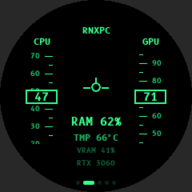
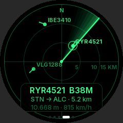
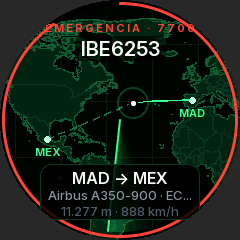
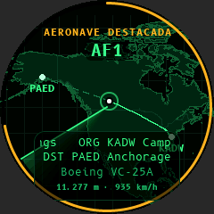

# 🖥️ DeskBuddy

> A tiny round desk companion for your PC, styled like a fighter-jet HUD 🛩️. It shows live hardware stats, works as a music remote, keeps the time and weather, runs a ✈️ **plane radar** of the sky above your home, and puts a pair of robot eyes 👀 on your desk. Everything runs over **Wi-Fi** 🛜, so the only cable is for power.

[](https://github.com/Ren0X1/DeskBuddy/actions/workflows/build.yml)
[](https://github.com/Ren0X1/DeskBuddy/releases/latest)

[](LICENSE)

<p align="center">
  
  
  
</p>
<p align="center">
  
  
  
</p>

Built for the cheap **ESP32-2424S012** board: an ESP32-C3 with a 1.28" 240×240 round IPS display and capacitive touch. Flashing DeskBuddy wipes the stock demo firmware. 🧹

---

## ✨ Features

The whole UI is **phosphor green on black**, set in [B612 Mono](https://github.com/polarsys/b612), the font Airbus designed for cockpit displays. ✈️

### 📊 PC Monitor: combat HUD
CPU and GPU run as airspeed/altitude-style tapes, a velocity vector climbs with the load, and RAM, GPU temperature, VRAM and the GPU model sit in the middle. Readouts turn 🟡 above 75% and 🔴 above 90%.

### 🎵 Music: target designator
- 🖼️ The cover sits in a **TGT box**, tinted green like a night-vision feed
- 🎚️ Stereo VU tapes, a scrolling title, and a range-staple progress bar
- ⏮️ ⏯️ ⏭️ 🔉 🔊 HUD soft keys. Tap the volume to 🔇 mute
- Works with **any** Windows media source: Spotify, YouTube, Apple Music, VLC and more

### 🕒 Clock: CRT scope
An analog dial whose seconds hand is a **radar sweep**, with scanlines, plus digital time, date, temperature and conditions from [Open-Meteo](https://open-meteo.com) 🌦️ for **your** coordinates.

### ✈️ Plane radar
An old-school phosphor radar 📡 of the sky around your home. Blips light up as the sweep passes and fade out slowly, and between updates they glide on dead reckoning.
- Every aircraft within **15 km** (configurable) with callsign, type and **full model** (Boeing 737-800, Airbus A321neo…)
- **Origin and destination on separate lines**, as ICAO code plus city: `ORG LEMG Málaga` / `DST EYKA Kaunas`
- Distance, altitude and speed. Tap to cycle through the aircraft
- Jumps to the radar when a new plane enters your airspace

### 🚨 Spotlight alerts: emergency vs. notable aircraft
When something interesting is flying **anywhere in the world**, DeskBuddy takes over the screen for a minute 🌍. You get a world map with the route flown (solid line), the way ahead (dashed), the departure and arrival airports and the aircraft pulsing behind the radar sweep. There are two kinds:

<p align="center">
  
  
</p>

| | 🔴 **EMERGENCIA** | 🟠 **AERONAVE DESTACADA** |
|---|---|---|
| **Fires when** | Any aircraft broadcasts an emergency squawk | An aircraft on your watch list is airborne |
| **Codes** | `7700` general emergency · `7600` radio failure · `7500` hijack | Callsigns (`AF1`, `AF2`, `EXEC1F`, `SAM`…) and types (`A337` Beluga XL, `BLCF` Dreamlifter, `A124`, `B52`…) |
| **Why it matters** | Something is going wrong right now. These flights shoot to the top of Flightradar24's "most tracked" list within minutes | Rare or famous aircraft people love to follow, like Air Force One or a Beluga carrying wings |
| **Colour** | Red caption and red countdown ring | Amber caption and amber countdown ring |
| **Priority** | Always first | When there's no emergency |

Each aircraft is shown once and then rests for 2 hours. You can edit the watch list, the duration and the cooldown in the web panel.

### 👀 Robot eyes: 84 animations
Leave the PC alone and DeskBuddy comes alive 🤖 with **84 animations** and 40 effects. Blinks, glances, winks, moods (happy, angry, sad, suspicious, sleepy…), hearts, stars, dizzy spirals, tears, a radar sweep, target lock, matrix rain, a countdown, sonar and hypnosis. Tap for something happy 😊, long-press to dismiss. At night it dozes off 😴, and it notices when a plane flies over.

All animations are defined once in [`tools/eyes.py`](tools/eyes.py), which generates the firmware table, so the web preview and the device always match.

### ⚙️ Web control panel
Open **http://deskbuddy.local** for a HUD-styled control panel:
- 📍 **Location**: search your town or type coordinates. Used for the radar and the weather
- ✈️ Radar on/off, radius and auto-jump
- 🚨 Alerts on/off, duration, and which callsigns and aircraft types to watch
- 🌙 Brightness, night hours and night brightness, when the eyes appear and when they fall asleep
- 🔧 Firmware update, reboot, change Wi-Fi

DeskBuddy keeps the settings and syncs them to the PC app on its own.

### 🌙 Night mode & auto-sleep · 📶 OTA updates · 📱 Wi-Fi setup portal
Brightness drops at night. If the PC app sends nothing for **2 minutes** (PC asleep, off or app closed), DeskBuddy parks on the clock and **switches the screen off**, then turns it back on by itself as soon as data arrives again (a touch also wakes it for 20 s). The timeout is set in the web panel. After the first USB flash, every update goes over Wi-Fi. On first boot a **DeskBuddy-Setup** hotspot lets you pick your network from your phone.

## 🧩 How it works

```
┌──────────── PC: DeskBuddy.exe ─────────┐        Wi-Fi / UDP          ┌──── DeskBuddy ────┐
│  • CPU/GPU/RAM (psutil + nvidia-smi)    │ ── stats / media / vu ────▶ │ :4210             │
│  • Now playing + cover (Windows SMTC)   │ ── cover art, world map ──▶ │ LVGL 8 HUD        │
│  • Volume + peak meter (Core Audio)     │ ── radar / alerts ────────▶ │                   │
│  • Planes (adsb.lol, hexdb, OurAirports)│ ◀──────── buttons, cfg ──── │ web panel :80     │
└─────────────────────────────────────────┘           :4211             └───────────────────┘
```

The PC app finds DeskBuddy by itself via mDNS (`deskbuddy.local`). Plane data comes from [adsb.lol](https://adsb.lol) (open ADS-B, ODbL), with routes from [hexdb.io](https://hexdb.io), cities from [OurAirports](https://ourairports.com) and the map from [Natural Earth](https://www.naturalearthdata.com). No API keys needed. 🔓

## 🛠️ Hardware

| Part | Pins |
|---|---|
| 🖼️ GC9A01 display (SPI) | SCLK 6 · MOSI 7 · DC 2 · CS 10 · BL 3 |
| 👆 CST816D touch (I²C `0x15`) | SDA 4 · SCL 5 · RST 1 |
| 🔋 Battery | The IP5306 charger has no fuel-gauge output, and every ADC-capable GPIO is taken, so DeskBuddy can't read the charge level without an extra I²C gauge such as a MAX17048 |

## 🚀 Quick start

1️⃣ **Flash the firmware once over USB.** Grab `deskbuddy-vX.Y.Z-full.bin` from the [latest release](https://github.com/Ren0X1/DeskBuddy/releases/latest) 📦:

```bash
pip install esptool
python -m esptool --chip esp32c3 --port COM3 erase-flash
python -m esptool --chip esp32c3 --port COM3 write-flash 0x0 deskbuddy-vX.Y.Z-full.bin
```

2️⃣ **Connect it to Wi-Fi.** Join **DeskBuddy-Setup** from your phone and pick your network. 📱

3️⃣ **Run `DeskBuddy-vX.Y.Z.exe` on Windows.** It sits in the system tray as a little green radar and starts with Windows. Right-click it for the control panel, the radar and alert toggles, the log, autostart and quit. 🖥️

4️⃣ **Set your location.** Open **http://deskbuddy.local** and search for your town. 📍

## 👩‍💻 Development

```bash
cd firmware
cp include/secrets.example.h include/secrets.h   # 🔑 optional: bake in Wi-Fi + OTA password
cp secrets.example.ini secrets.ini               # 🔑 OTA host/password for uploads
pio run -e usb -t upload    # 🔌 over USB
pio run -e ota -t upload    # 📶 over Wi-Fi (retries automatically)
```

PC app from source: `pip install -r agent/requirements.txt` then `python agent/deskbuddy_agent.py`. Build the .exe with `python agent/build_exe.py`.

| Tool | What it does |
|---|---|
| `tools/eyes.py` | 👀 Eye animation catalogue, generates `firmware/src/eye_anims.h` |
| `tools/fontgen.py` | 🔤 B612 Mono + Material Icons into LVGL fonts (no Node needed) |
| `tools/screenshot.py` | 📸 Dumps the live screen over USB |
| `tools/demo.py` | 🎬 Flyover and spotlight demo on a real device |
| `tools/ota_upload.py` | 📶 Wi-Fi firmware upload with retries |

Serial console: `shot` · `tile N` · `anim N` · `eye` · `sleepy` · `alert` · `alertmap` · `ota N` · `portal` · `mem` · `fps` · `i2cscan` · `wifireset`

### 🏷️ Releasing

```bash
git tag v3.0.0 && git push origin v3.0.0
```

GitHub Actions builds the firmware images and **DeskBuddy.exe**, then publishes them all in one release. 🤖

## 🗂️ Project layout

```
DeskBuddy/
├── firmware/src/
│   ├── hud.cpp          🖊️ immediate-mode HUD drawing
│   ├── ui_main.cpp      🧭 tiles, CRT clock, HUD monitor, info, screen policy
│   ├── ui_music.cpp     🎵 target-designator player
│   ├── ui_radar.cpp     ✈️ radar + spotlight alerts
│   ├── ui_eye.cpp       👀 eye engine (eye_anims.h is generated)
│   ├── net.cpp          📶 Wi-Fi, portal, UDP, OTA, weather, web API
│   ├── settings.cpp     ⚙️ settings in NVS
│   └── webpanel.h       🌐 control panel page
├── agent/               🐍 PC app (tray, stats, media, radar) + build_exe.py
├── tools/               🧰 generators, screenshot, demo, OTA
└── .github/workflows/   🤖 CI + releases
```

## 🗺️ Roadmap

- [x] 📶 OTA updates · 🖼️ album art · 🌦️ weather · 🔤 accents
- [x] ✈️ Plane radar + spotlight alerts with ICAO routes
- [x] 🛩️ Military HUD redesign · 👀 84 eye animations
- [x] ⚙️ Web control panel · 🖥️ Windows .exe
- [ ] 🔋 Battery gauge (needs a MAX17048 add-on)
- [ ] 🎙️ Mic mute toggle for Discord/calls
- [ ] 🐧 Linux / macOS app

## 🙏 Credits

[LVGL](https://lvgl.io) · [LovyanGFX](https://github.com/lovyan03/LovyanGFX) · [B612](https://github.com/polarsys/b612) (OFL) · [Material Icons](https://fonts.google.com/icons) (Apache 2.0) · [Open-Meteo](https://open-meteo.com) · [adsb.lol](https://adsb.lol) · [hexdb.io](https://hexdb.io) · [OurAirports](https://ourairports.com) · [Natural Earth](https://www.naturalearthdata.com)

## 📜 License

[MIT](LICENSE). Do whatever you want with it. 🤘
