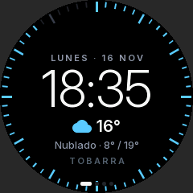
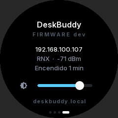
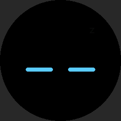
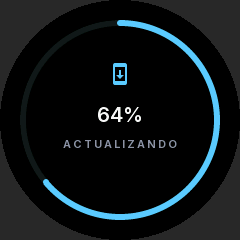
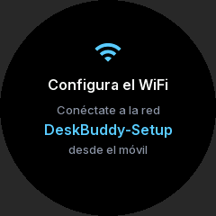

# 🖥️ DeskBuddy

> A tiny round desk companion for your PC 🤖: live hardware stats, a music remote with album art, a clock with weather, and a pair of eyes that keep you company. Everything runs over **Wi-Fi** 🛜, so the only cable is for power.

[](https://github.com/Ren0X1/DeskBuddy/actions/workflows/build.yml)
[](https://github.com/Ren0X1/DeskBuddy/releases/latest)

[](LICENSE)

<p align="center">
  
  
  
  
</p>

Built for the cheap **ESP32-2424S012** board: an ESP32-C3 with a 1.28" 240×240 round IPS display and capacitive touch. Flashing DeskBuddy wipes the stock demo firmware. 🧹

---

## ✨ Features

### 📊 PC Monitor
A tachometer-style CPU gauge with a red zone, plus GPU load, RAM and GPU temperature underneath. Ticks turn 🟡 above 75% and 🔴 above 90%.

### 🎵 Music
- 🖼️ **Album art** and an accent color pulled from the cover, the way Apple Music does it
- 🎚️ Stereo VU meters, a progress ring, title and artist (with full **á é ñ ü** support)
- ⏮️ ⏯️ ⏭️ Media controls and 🔉🔊 volume. Tap the volume to 🔇 mute
- Works with **any** Windows media source: Spotify, YouTube, Apple Music, VLC and more
- Jumps to this screen automatically when a song starts

### 🕒 Clock & Weather
NTP time with a sweeping seconds dial. Current weather, the day's min/max and your city from [Open-Meteo](https://open-meteo.com) 🌦️, no API key needed.

### 👀 Idle Eyes
Leave the PC alone for 2 minutes and DeskBuddy wakes up 🤖. It blinks, looks around and smiles when you tap it 😊. After 15 minutes, or at night, it dozes off 😴. Long-press to dismiss.

### 🌙 Night mode & auto-sleep
- Brightness is capped from 23:00 to 08:00
- When the PC sleeps or shuts down, DeskBuddy shows the clock and dims. At night the screen switches off completely
- A touch wakes it up 👆

### 📶 Wi-Fi updates (OTA)
After the first USB flash, every update goes over Wi-Fi, with a progress ring on screen.

### 📱 Wi-Fi setup portal
On first boot DeskBuddy creates a **DeskBuddy-Setup** hotspot. Join it from your phone, pick your network, done.

<p align="center">
  
  
  
  
</p>

## 🧩 How it works

```
┌──────────── PC (Windows) ─────────────┐        Wi-Fi / UDP         ┌──── DeskBuddy ────┐
│ deskbuddy_agent.py                    │ ── stats   (1 Hz) ───────▶ │ :4210             │
│  • psutil + nvidia-smi → CPU/GPU/RAM  │ ── media   (2 Hz) ───────▶ │ LVGL 8 UI         │
│  • Windows SMTC → now playing + art   │ ── art     (on change) ──▶ │                   │
│  • Core Audio → volume + peak meter   │ ── vu      (25 Hz) ──────▶ │                   │
│  • GetLastInputInfo → idle time       │ ◀──────── cmd (buttons) ── │ touch             │
└───────────────────────────────────────┘           :4211            └───────────────────┘
```

The agent finds DeskBuddy through mDNS (`deskbuddy.local`) or its UDP hello broadcast. Nothing to configure on the PC. ✨

## 🛠️ Hardware

| Part | Pins |
|---|---|
| 🖼️ GC9A01 display (SPI) | SCLK 6 · MOSI 7 · DC 2 · CS 10 · BL 3 |
| 👆 CST816D touch (I²C `0x15`) | SDA 4 · SCL 5 · RST 1 |
| 🔌 USB | Native USB-Serial/JTAG |

## 🚀 Quick start

### 1️⃣ Flash the firmware (first time, USB)

Grab `deskbuddy-vX.Y.Z-full.bin` from the [latest release](https://github.com/Ren0X1/DeskBuddy/releases/latest) 📦 and run:

```bash
pip install esptool
python -m esptool --chip esp32c3 --port COM3 erase-flash
python -m esptool --chip esp32c3 --port COM3 write-flash 0x0 deskbuddy-vX.Y.Z-full.bin
```

Then connect your phone to **DeskBuddy-Setup** 📱 and choose your Wi-Fi.

### 2️⃣ Install the PC agent (Windows)

```powershell
pip install -r agent/requirements.txt
powershell -ExecutionPolicy Bypass -File agent/install_autostart.ps1
```

This runs the agent hidden at every login 🔁. To remove it: `install_autostart.ps1 -Uninstall`. Logs go to `agent/agent.log`. 📝

## 👩‍💻 Development

```bash
cd firmware
cp include/secrets.example.h include/secrets.h   # 🔑 optional: bake in Wi-Fi + OTA password
cp secrets.example.ini secrets.ini               # 🔑 OTA host/password for uploads
pio run -e usb -t upload    # 🔌 over USB
pio run -e ota -t upload    # 📶 over Wi-Fi
```

| Tool | What it does |
|---|---|
| `tools/fontgen.py` | 🔤 Turns Inter + Material Icons into LVGL fonts (Latin-1 + icons, no Node needed) |
| `tools/screenshot.py` | 📸 Dumps the live screen over USB: `python tools/screenshot.py --tile 0 1 2 3` |

Serial console commands: `shot` · `tile N` · `eye` · `sleepy` · `ota N` · `portal` · `wifireset`

Tweak night hours, idle timers, timezone or a fixed weather location in [`firmware/include/config.h`](firmware/include/config.h). ⚙️

### 🏷️ Releasing

```bash
git tag v2.0.0 && git push origin v2.0.0
```

GitHub Actions builds everything and publishes a release with the full image, the OTA image and the agent zip. 🤖

## 🗂️ Project layout

```
DeskBuddy/
├── firmware/              🔧 PlatformIO project (Arduino + LVGL 8 + LovyanGFX)
│   ├── include/           ⚙️ config.h, lv_conf.h, secrets
│   └── src/
│       ├── hw.cpp         🖼️ display, touch, backlight
│       ├── net.cpp        📶 Wi-Fi, portal, UDP, OTA, weather
│       ├── ui_main.cpp    🧭 tiles, clock, monitor, info, policy
│       ├── ui_music.cpp   🎵 player
│       ├── ui_eye.cpp     👀 idle eyes
│       └── fonts/         🔤 generated fonts
├── agent/                 🐍 Windows PC agent
├── tools/                 🧰 fontgen + screenshot
└── .github/workflows/     🤖 CI + releases
```

## 🗺️ Roadmap

- [x] 📶 OTA updates over Wi-Fi
- [x] 🖼️ Album art
- [x] 👀 Idle eyes
- [x] 🌙 Night mode & auto-sleep
- [x] 🌦️ Weather
- [x] 🔤 Accents (á é ñ)
- [ ] 🎙️ Mic mute toggle for Discord/calls
- [ ] 🐧 Linux / macOS agent
- [ ] 🌐 Web flasher

## 🙏 Credits

[LVGL](https://lvgl.io) · [LovyanGFX](https://github.com/lovyan03/LovyanGFX) · [Inter](https://rsms.me/inter/) (OFL) · [Material Icons](https://fonts.google.com/icons) (Apache 2.0) · [Open-Meteo](https://open-meteo.com)

## 📜 License

[MIT](LICENSE). Do whatever you want with it. 🤘
